<p align="center">
  
</p>

<p align="center">
  <a href="https://www.linkedin.com/in/atwilcybersecurity/"></a>
  <a href="https://agentbounty.ai"></a>
  <a href="https://mongooseai.io"></a>
  <a href="mailto:security@agentbounty.ai"></a>
</p>

---

### `wil@ramos:~$ cat ./profile.yml`

```yaml
name:       Wil Ramos
handle:     atwilsecurity
class:      security engineer / founder
xp:         21+ years
origin:     U.S. Navy Reserve -> JPMorgan Chase -> Ernst & Young -> Dell SecureWorks -> Wolters Kluwer
alignment:  breaker turned builder
motto:      "from breaking stuff to building stuff"
speaks:     [English, Español]
```

### `wil@ramos:~$ ps aux | grep wil`

```diff
+ [RUNNING]  Lead Security & AI Engineer @ Wolters Kluwer
             multi-cloud security across Azure, GCP and AWS
             AI + API security governance, DevSecOps pipelines (SAST/DAST/IAST/SCA/IaC)
             Sentinel SOAR playbooks orchestrating 15+ security tools, XSOAR integrations

+ [RUNNING]  Founder & CEO @ Agent Bounty
             21+ AI agents: scan -> prove it's exploitable -> write the fix -> learn
             only validated findings reach a human. SOC 2 Type I.

+ [RUNNING]  Builder @ Mongoose AI
             AI security posture: models, agent identities, AI harnesses

+ [RUNNING]  Host @ Automate or Die Trying          50K+ subscribers
+ [RUNNING]  Principal @ Cyber Security Privacy LLC  since 2016

- [KILLED]   alert fatigue
- [KILLED]   false positives nobody triages
```

### `wil@ramos:~$ tail ./war_stories.log`

```log
[secureworks]    ran vuln mgmt for Comcast/NBCU: 1M+ IPs, 1,200 external web apps, 80 Qualys scanners
[wolters kluwer] shift-left onboarding: Jira form -> Logic Apps approvals -> Orca checks -> provision
[wolters kluwer] security framework: 14 domains, 348 controls, 166 threats
                 RAG assistant w/ citation pinning + prompt-injection guards, hardened MCP server,
                 every published number checked by an independent judge
[always]         find it fast. prove it's real. fix it before an attacker does.
```

### `wil@ramos:~$ ls ./arsenal`

```bash
cloud/     azure  gcp  aws  terraform  kubernetes  docker
code/      python  typescript  fastapi  powershell  bash
detect/    sentinel  xsoar  splunk
scan/      orca  snyk  semgrep  trivy
offense/   burp  metasploit  nmap  cobalt-strike
ai/        llm-security  owasp-llm-top-10  mcp  agents
```

### `wil@ramos:~$ cat ~/.certs`

```diff
+ [✓] aws     security specialty · solutions architect pro · generative ai developer pro · ml specialty
+ [✓] azure   cybersecurity architect expert · solutions architect expert
+ [✓] gcp     cloud security engineer · cloud architect · ml engineer · agentic architect
+ [✓] isaca   cisa · cism · crisc
+ [✓] misc    certified devsecops professional · ceh
! [~] in training   offsec ai red teamer (OSAI)
```

### `wil@ramos:~$ exit`

```console
logout. connection to atwilsecurity closed.
"security is not a product, but a process." - bruce schneier
```
